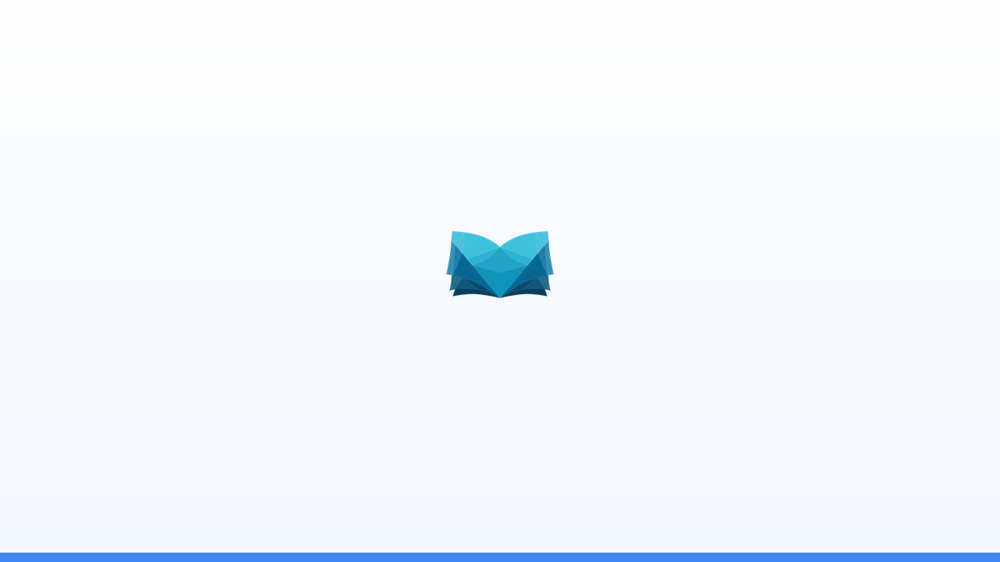
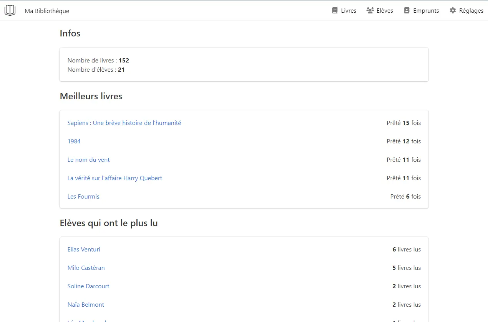
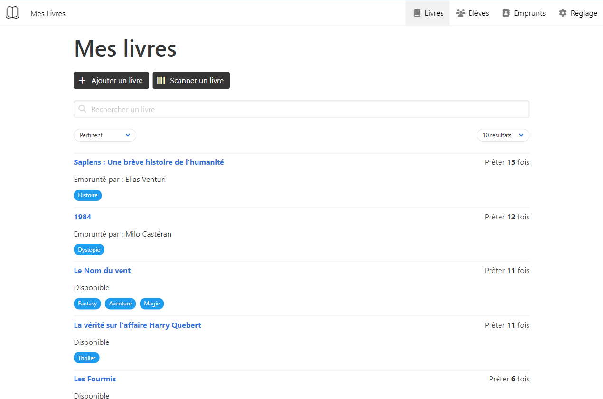
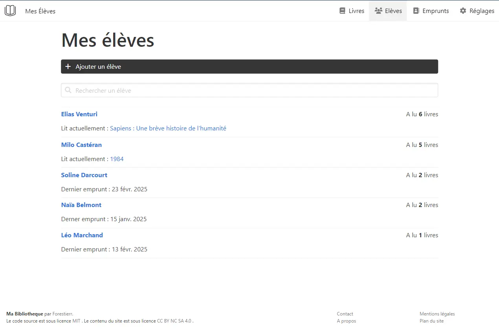

  

<h1 align="center">Livres en Classe</h1>

  <strong>The free classroom library management software for teachers</strong> 
  Catalog your books by barcode scan, manage loans, track student reading progress, and foster a love of reading in your classroom.

  <a href="https://livresenclasse.com/en/"><strong>Visit the official website: livresenclasse.com »</strong></a>

  <a href="README.md">Version française</a> •
  <a href="#-why-use-livres-en-classe-">Features</a> •
  <a href="#-application-overview">Overview</a> •
  <a href="#-plans--pricing">Plans & Pricing</a> •
  <a href="#-self-hosting--development">Self-Hosting</a> •
  <a href="#-license">License</a>

  
  
  
  
  

---

  

---

## ✨ Why use Livres en Classe?

Designed specifically for primary and elementary school teachers, **Livres en Classe** replaces handwritten paper logbooks and messy spreadsheets with a fluid, visual, and modern web application.

| ⏱️ Save time | 📊 Track progress | 📱 100% Mobile & Camera |
| :--- | :--- | :--- |
| **No more messy paper logbooks.** Register a loan or a return in one click. Find any book instantly with ultra-fast search. | **Analyze your students' reading habits.** See who read what, spot overdue books automatically, and encourage reluctant readers. | **Scan directly from your smartphone.** Use your phone or tablet camera without purchasing expensive barcode equipment. |

---

## 🔍 Application Overview

### 1. A complete overview of your school library
The dashboard centralizes all critical classroom metrics: book count, enrolled students, active loans, annual reading activity chart, and priority overdue alerts with one-click inline returns.

  

---

### 2. All classroom books in one place
Scan ISBN barcodes with your device's camera. The app automatically fetches bibliographic records (title, author, publisher, cover artwork) across the **Bibliothèque nationale de France (BnF)**, **Google Books**, and **Open Library**.

  

---

### 3. Who read what? Track your students
Follow each student's reading journey, organize themed book bins with custom tags, and export annual end-of-year reading summaries when closing your class.

  

---

## 💎 Plans & Pricing

Fair, transparent pricing tailored for classroom budgets:

| Feature | 🟢 Free Plan | ⭐️ Premium Plan |
| :--- | :---: | :---: |
| **Price** | **0.- CHF** / lifetime | **3.- CHF / month** or **30.- CHF / year** |
| **Maximum students** | Up to 40 students | **Unlimited** |
| **Books in catalog** | Up to 500 books | **Unlimited** |
| **Barcode scans** | 30 scans per week | **Unlimited** |
| **Loan history** | 10 months history | **Unlimited** |
| **Data exports** | Online viewing | **Full Excel exports** (books, students, loans) |
| **Classroom tools & printing** | — | **Printable vector barcode sheets & bin labels** |
| **Annual classroom archive** | Online summary | **Official printable report** (top books & readers) |

🎁 **30-day free trial** granted automatically to all new accounts, no credit card required.

👉 **[Sign up for free on LivresEnClasse.com »](https://livresenclasse.com/en/)**

---

## 🛠️ Self-Hosting & Development

**Livres en Classe** is a *Source-Available* project. The official, production-ready, hosted service is operated on [livresenclasse.com](https://livresenclasse.com).

For developers wishing to contribute to the code or run their own autonomous instance:

* **Local Installation & Self-hosting Guide**: [**`docs/self-hosting.md`**](docs/self-hosting.md)  
  *(Prerequisites: Python 3.12, SQLite, API keys configuration, and HTTPS certificate for camera support).*
* **Detailed Software Architecture**: [**`docs/architecture.md`**](docs/architecture.md)
* **Database Schema & Migrations**: [**`docs/base-de-donnees.md`**](docs/base-de-donnees.md)
* **Production Deployment Guide (Docker / Traefik)**: [**`docs/deploiement.md`**](docs/deploiement.md)
* **Contribution Guidelines**: [**`CONTRIBUTING.md`**](CONTRIBUTING.md)

### Tech Stack
- **Backend**: Python 3.12, Flask 3, Flask-Login, Flask-Babel 4 (i18n French / English / German)
- **Database**: SQLAlchemy 2.0, Flask-Migrate (Alembic), SQLite
- **Frontend**: Jinja2, Bulma CSS, HTMX, Vanilla JavaScript, Service Worker (PWA)
- **Integrated Services**: BnF SRU API, Google Books API, Open Library, Stripe Checkout, hCaptcha

---

## 📜 License

This project is licensed under the **[PolyForm Noncommercial License 1.0.0](LICENSE.md)** (Source-Available):

- **Allowed**: Personal, pedagogical, and educational use (schools, teachers, non-profit education), security auditing, and open-source contributions.
- **Prohibited**: Commercial exploitation, monetization, resale, or competing paid SaaS hosting without prior written consent from the author.

---

  Crafted with care for teachers and their students 📖 
  <strong><a href="https://livresenclasse.com/en/">LivresEnClasse.com</a></strong>

