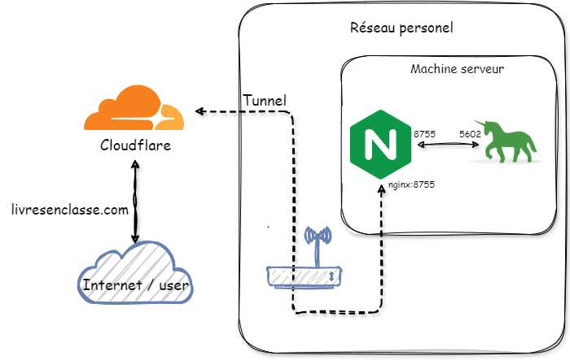
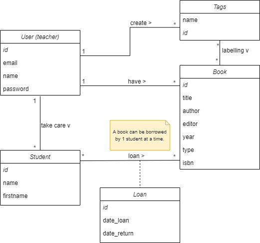

# Bibliotheque flask

[Version française](README.md)

<strong>My Bibliotheque</strong> is a web application specifically designed to meet the needs of teachers in managing 
their classroom library. This intuitive platform allows them to easily centralise and organise their book collection.
They can add new books, modify existing information or delete books that are no longer needed. What's more, the 
application provides detailed information on the books borrowed by their students, so they know which books have been 
borrowed, by whom and for how long. Thanks to LivresEnClasse.com, teachers can encourage reading while keeping a clear 
and precise overview of the use of their library's resources.

> [!NOTE]
> This document has been translated from French to English using [DeepL](https://www.deepl.com/translator).

## Features

- Add, delete, modify a book
- Add, delete or modify a student
- Scan a book's barcode
- Borrowing management
- Login / logout

## Installation

### Create a virtual environment

```bash
python -m venv venv
source venv/bin/activate
```

Then install the dependencies:

```bash
pip install -r project/requirements.txt
```

Modify the `.env' file to set the environment variables.
The `.env.example` file has all the default values, you just need to copy the file and add your 
copy the file and add your own values.

```bash
cp .env.example .env
```

### Create the database

```bash
flask db init
flask db migrate
flask db upgrade
```

> [!TIP]
> You can use the `flask db --help` command to see all available commands.

### Update the database

If you change the data model, you must update the database.

```bash
flask db migrate -m "message"
flask db upgrade
```

### Run the server

```bash
$env:FLASK_APP = "project"
flask run -p 80 -h 0.0.0.0
```

And go to http://127.0.0.1:80

> [!TIP]
> You can use the `flask run --help` command to see all available options.

> [!CAUTION]
> Flask does not launch a WSGI server, you must use a production WSGI server like Gunicorn.

## Published

To publish the application, I decided to use [Cloudflare Tunnel](https://developers.cloudflare.com/cloudflare-one/connections/connect-networks/)
nginx and gunicorn. This allows me to publish the application on my personal server and make it accessible under
a custom domain name [Cloudflare Registrar](https://www.cloudflare.com/fr-fr/products/registrar/).

To do this I took inspiration from the blog post by [austinsnerdythings](https://austinsnerdythings.com/2023/11/01/using-github-actions-to-deploy-a-flask-nginx-cloudflared-tunnel-docker-compose-stack/).
But without using GitHub Actions, you're free to use it.

> [!CAUTION]
> This solution does not automatically make your application secure. You still need to focus on security. Any vulnerability in your web application could allow an attacker to gain a foothold in your network. Your Docker host should be isolated from the rest of your network by a firewall as a first step to prevent intrusion into other computers/services/systems on your network. All subsequent steps should focus on the usual attack vectors (SQL injection, system updates, etc.).

### Infrastructure diagram



## Launch the application

Firstly, you need to create a `docker-compose.yml` file at the root of the project.

```yaml
command: tunnel --no-autoupdate run --token ${CF_TOCKEN}
```

By replacing `${CF_TOCKEN}` with your Cloudflare token.

### Build and launch the application

```bash
docker-compose up --build
```

> [!TIP]
> You can use the `-d` option to launch containers in the background.

### Stop the application

```bash
docker-compose down
```

## Database

The database is a SQLite database. Stored in the `instance\db.sqlite` file.

### Database schema



_The **User** is a professor._

## License

This project is licensed under the MIT licence - see the [LICENSE](LICENSE.md) file for more details.

##


