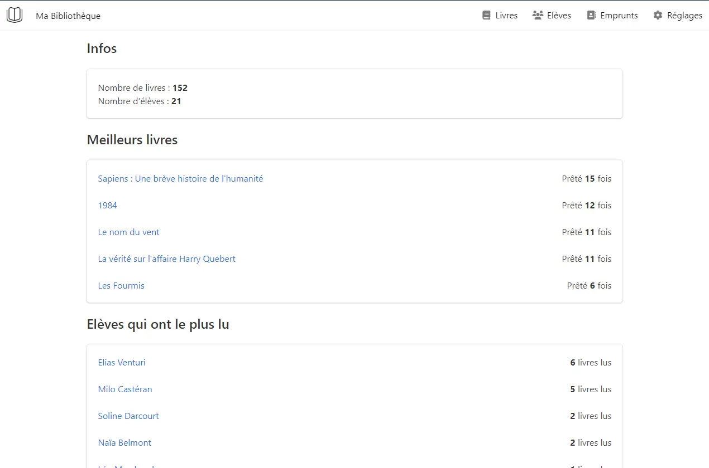
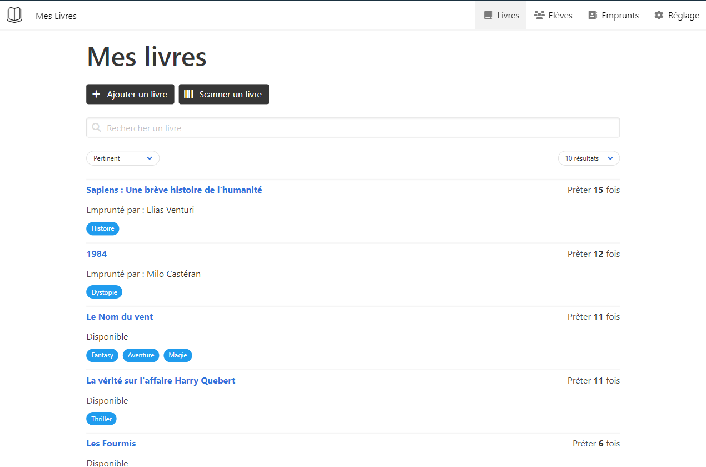
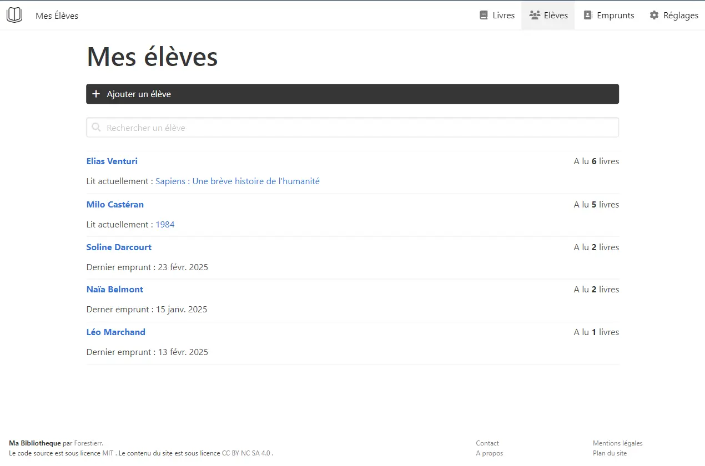

  

<h1 align="center">Livres en Classe</h1>

  <strong>Le logiciel de gestion de bibliothèque de classe gratuit pour les enseignants</strong> 
  Cataloguez vos livres par scan code-barres, gérez les prêts, suivez les emprunts des élèves et développez la lecture dans votre classe.

  <a href="https://livresenclasse.com"><strong>Accéder au site officiel : livresenclasse.com →</strong></a>

  <a href="README.en.md">English version</a> •
  <a href="#pourquoi-utiliser-livres-en-classe-">Fonctionnalités</a> •
  <a href="#aperçu-de-lapplication">Aperçu</a> •
  <a href="#formules--tarifs">Formules & Tarifs</a> •
  <a href="#auto-hébergement--développement">Self-Hosting</a> •
  <a href="#licence">Licence</a>

  
  
  
  
  

---

## Pourquoi utiliser Livres en Classe ?

Conçu spécialement pour le quotidien des enseignants d'école primaire et de maternelle, **Livres en Classe** remplace les cahiers d'emprunt manuscrits et les tableurs complexes par une interface fluide et visuelle.

| Gagnez du temps | Suivez la progression | 100% Mobile & Caméra |
| :--- | :--- | :--- |
| **Fini les cahiers brouillons.** En quelques clics, enregistrez un prêt ou un retour. Retrouvez un livre instantanément grâce à la recherche rapide. | **Analysez les lectures de vos élèves.** Visualisez qui a lu quoi, repérez les retards et encouragez la curiosité de ceux qui lisent moins. | **Scannez directement avec votre smartphone.** Utilisez la caméra de votre téléphone ou tablette, sans investir dans une douchette coûteuse. |

---

## Aperçu de l'application

### 1. Une vue globale de votre bibliothèque scolaire
Le tableau de bord centralise toutes les informations clés de votre classe : nombre d'ouvrages, élèves inscrits, emprunts actifs, graphique d'activité sur l'année et alertes prioritaires des prêts en retard avec retours rapides en un clic.

  

---

### 2. Tous les livres de la classe au même endroit
Scannez le code-barres ISBN de vos livres pédagogiques avec la caméra de votre téléphone. L'application récupère automatiquement la fiche bibliographique (titre, auteur, éditeur, image de couverture) en interrogeant la **Bibliothèque nationale de France (BnF)**, **Google Books** et **Open Library**.

  

---

### 3. Qui a lu quoi ? Suivez vos élèves
Suivez le parcours de chaque élève, attribuez des étiquettes personnalisées aux bacs de livres et téléchargez vos bilans annuels de promotion lors de la clôture de l'année scolaire.

  

---

## Formules & Tarifs

Une tarification juste et transparente pensée pour les budgets de classe des enseignants :

| Caractéristique | Formule Gratuite | Formule Premium |
| :--- | :---: | :---: |
| **Tarif** | **0.- CHF** / à vie | **3.- CHF / mois** ou **30.- CHF / an** |
| **Élèves maximum** | Jusqu'à 40 élèves | **Illimité** |
| **Livres au catalogue** | Jusqu'à 500 livres | **Illimité** |
| **Scans code-barres** | 30 scans par semaine | **Illimité** |
| **Historique des prêts** | 10 mois d'historique | **Illimité** |
| **Exports de données** | Consultation en ligne | **Exports Excel complets** (livres, élèves, prêts) |
| **Outils de classe & impressions** | — | **Planches de codes-barres vectoriels & étiquettes de bacs** |
| **Clôture de classe annuelle** | Bilan en ligne | **Bilan officiel imprimable** (top livres & lecteurs) |

**Essai gratuit de 30 jours** accordé automatiquement à chaque nouvel inscrit, sans carte bancaire requise.

**[Créer un compte enseignant gratuitement sur LivresEnClasse.com →](https://livresenclasse.com)**

---

## Auto-hébergement & Développement

**Livres en Classe** est un projet distribué sous modèle *Source-Available*. La solution officielle, prête à l'emploi et hébergée en Suisse / Europe, est accessible directement sur [livresenclasse.com](https://livresenclasse.com).

Si vous êtes développeur, que vous souhaitez contribuer au projet ou déployer votre propre instance autonome, l'application est facilement installable :

* **Guide d'installation locale & Self-hosting** : [**`docs/self-hosting.md`**](docs/self-hosting.md)  
  *(Prérequis : Python 3.12, SQLite, configuration des clés d'APIs et certificat HTTPS pour la caméra).*
* **Architecture logicielle détaillée** : [**`docs/architecture.md`**](docs/architecture.md)
* **Schéma de base de données & Migrations** : [**`docs/base-de-donnees.md`**](docs/base-de-donnees.md)
* **Guide de déploiement en production (Docker / Traefik)** : [**`docs/deploiement.md`**](docs/deploiement.md)
* **Règles de contribution** : [**`CONTRIBUTING.md`**](CONTRIBUTING.md)

### Stack technique
- **Backend** : Python 3.12, Flask 3, Flask-Login, Flask-Babel 4 (i18n Français / Anglais / Allemand)
- **Base de données** : SQLAlchemy 2.0, Flask-Migrate (Alembic), SQLite
- **Frontend** : Jinja2, Bulma CSS, HTMX, Vanilla JavaScript, Service Worker (PWA)
- **Services intégrés** : BnF SRU API, Google Books API, Open Library, Stripe Checkout, hCaptcha

---

## Licence

Ce projet est distribué sous licence **[PolyForm Noncommercial License 1.0.0](LICENSE.md)** (Source-Available) :

- **Autorisé** : Utilisation personnelle, pédagogique et scolaire (écoles, enseignants, associations éducatives), audit de sécurité et contributions open source.
- **Interdit** : Toute exploitation commerciale, monétisation, revente ou hébergement payant concurrent sans accord écrit préalable de l'auteur.

---

  Fait avec passion pour les enseignants et leurs élèves 
  <strong><a href="https://livresenclasse.com">LivresEnClasse.com</a></strong>

