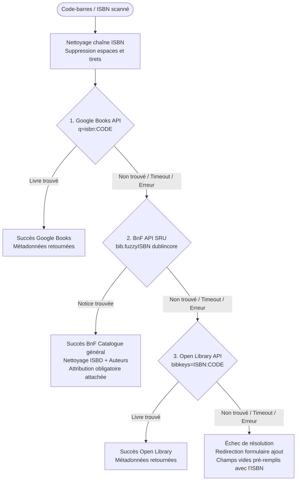

# APIs et Services Externes - Livres en Classe

Ce document recense l'ensemble des APIs tierces et services externes intégrés à **Livres en Classe**, leurs protocoles de communication, la chaîne de repli (fallback), ainsi que les obligations légales de citation associées.

---

## Sommaire

1. [Chaîne de résolution bibliographique par code ISBN](#1-chaîne-de-résolution-bibliographique-par-code-isbn)
2. [1. Google Books API v1](#2-1-google-books-api-v1)
3. [2. Bibliothèque nationale de France (BnF — API SRU)](#3-2-bibliothèque-nationale-de-france-bnf--api-sru)
   * [Obligations légales de réutilisation & Attribution](#obligations-légales-de-réutilisation--attribution)
4. [3. Open Library API](#4-3-open-library-api)
5. [4. Stripe API (Abonnements & Webhooks)](#5-4-stripe-api-abonnements--webhooks)
6. [5. hCaptcha (Protection anti-bot)](#6-5-hcaptcha-protection-anti-bot)
7. [6. Cloudflare Tunnel & DNS Edge](#7-6-cloudflare-tunnel--dns-edge)
8. [Questions ouvertes](#8-questions-ouvertes)

---

## 1. Chaîne de résolution bibliographique par code ISBN

Lorsqu'un enseignant scanne un code-barres avec sa caméra ou saisit un ISBN, la fonction centralisée `get_book_from_api(isbn)` dans [`project/livre.py`](../project/livre.py) orchestre une cascade de recherche pour maximiser le taux de découverte :

* **Gestion du quota de scan** : Si la cascade échoue et qu'aucun livre n'est identifié par les APIs, le compteur de scans hebdomadaires (`free_scans_used`) de l'utilisateur gratuit **n'est pas débité**.

---

## 2. 1. Google Books API v1

* **Rôle** : Première source d'interrogation bibliographique mondiale.
* **Endpoint** : `https://www.googleapis.com/books/v1/volumes`
* **Méthode** : `GET`
* **Paramètres transmis** :
  * `q=isbn:{clean_isbn}` : Recherche exacte par ISBN-10 ou ISBN-13.
  * `key={GOOGLE_BOOK_API_KEY}` : *(Optionnel)* Clé d'API renseignée dans le `.env`. Si absente, l'appel s'exécute en mode anonyme public.
* **En-têtes HTTP** : `User-Agent: Bibliotheque-Flask/1.0`
* **Extraction des champs** :
  * Titre : `volumeInfo.title`
  * Auteurs : `volumeInfo.authors` (fusionnés avec `", "`)
  * Éditeur : `volumeInfo.publisher`
  * Année : `volumeInfo.publishedDate` (extrait sur 4 chiffres via `\b(19\d\d|20\d\d)\b`)
  * Genre / Type : `volumeInfo.subtitle`
* **Résilience & Quotas** :
  * Timeout : 5 secondes (`timeout=5`).
  * Exceptions interceptées : `requests.RequestException`, `ValueError` (JSON corrompu).
  * Quotas officiels Google : 1 000 requêtes/jour sans clé d'API, 100 000 requêtes gratuites/jour avec clé de projet Google Cloud.

---

## 3. 2. Bibliothèque nationale de France (BnF — API SRU)

* **Rôle** : Base de référence absolue du dépôt légal français. Trouve les ouvrages scolaires, manuels pédagogiques, BD francophones et albums de jeunesse fréquemment absents de Google Books.
* **Endpoint** : `https://catalogue.bnf.fr/api/SRU`
* **Méthode** : `GET`
* **Paramètres transmis** :
  * `version=1.2` : Version du protocole SRU (Search/Retrieve via URL).
  * `operation=searchRetrieve` : Opération de recherche et récupération.
  * `query=bib.fuzzyISBN all "{clean_isbn}"` : Recherche tolérante prenant en charge ISBN-10, ISBN-13 ou EAN.
  * `recordSchema=dublincore` : Schéma de métadonnées simplifié XML (titre, créateur, éditeur, date, description).
  * `maximumRecords=1` : Limite à un seul résultat.
* **Extraction et algorithmes de nettoyage des métadonnées** :
  * **Titre & Sous-titre** (`dc:title`) : Le catalogue BnF suit la norme ISBD séparant le titre et la mention de responsabilité par ` / ` (ex: `"Le petit prince / Antoine de Saint-Exupéry"`). Le titre est extrait avant le ` / `. Si un sous-titre est présent avec ` : `, il est séparé pour le champ `type`.
  * **Collection** (`dc:description`) : Si aucun sous-titre n'est présent, la mention de collection (ex: `Collection : Folio junior ; 100`) est extraite pour renseigner le champ `type`.
  * **Auteurs** (`dc:creator`) : Les notices BnF sont au format catalographique (ex: `"Saint-Exupéry, Antoine de (1900-1944). Auteur du texte"`). L'algorithme élimine les mentions de rôles (`. Auteur...`, `. Illustrateur...`), supprime les dates de naissance/mort entre parenthèses, et inverse le format `Nom, Prénom` en `Prénom Nom`.
  * **Éditeur** (`dc:publisher`) : La ville entre parenthèses (ex: `"Gallimard (Paris)"`) est nettoyée pour conserver l'éditeur propre (`"Gallimard"`).
  * **Année** (`dc:date`) : Extrait sur 4 chiffres.
* **Résilience & Quotas** :
  * Timeout : 5 secondes (`timeout=5`).
  * Parsing : Analyse du flux XML via `xml.etree.ElementTree`.
  * Quotas : Accès public, gratuit et ouvert, sans clé d'API requise.

### Obligations légales de réutilisation & Attribution

Les données du Catalogue général de la BnF sont mises à disposition sous **Licence Ouverte (Open Licence Etalab)**. La licence impose expressément :
> *« L’utilisateur est libre de réutiliser l'information sous réserve de mentionner sa paternité, la source (au minimum sous la forme d’un lien) et la date de dernière mise à jour de l’information réutilisée. »*

Pour respecter cette obligation légale :
1. **Traçabilité en base de données** : Le modèle `Book` conserve la source (`metadata_source = 'bnf'`) et la date exacte de récupération (`metadata_date = datetime.now().date()`).
2. **Affichage sur la fiche du livre** ([`project/templates/livre/livre_info.html`](../project/templates/livre/livre_info.html)) : Affichage pérenne au bas du descriptif du livre :
   > *« Source : BnF, catalogue général, données récupérées le JJ/MM/AAAA »*
3. **Affichage sur le formulaire d'ajout** ([`project/templates/livre/livre_ajout.html`](../project/templates/livre/livre_ajout.html)) : Notification informative lors du pré-remplissage automatique des champs.
4. **Mentions Légales** ([`project/templates/mentions-legales.html`](../project/templates/mentions-legales.html)) : Mention expresse de la réutilisation des données de la BnF sous Licence Ouverte.

---

## 4. 3. Open Library API

* **Rôle** : Dernier niveau de fallback pour les titres internationaux ou anciens.
* **Endpoint** : `https://openlibrary.org/api/books`
* **Méthode** : `GET`
* **Paramètres transmis** :
  * `bibkeys=ISBN:{clean_isbn}`
  * `format=json`
  * `jscmd=data` : Récupère les métadonnées complètes (titre, auteurs, éditeurs, date).
* **En-têtes HTTP** : `User-Agent: Bibliotheque-Flask/1.0 ({contact_email})` (bonne pratique demandée par la fondation Internet Archive).
* **Extraction des champs** :
  * Titre : `book.title`
  * Auteurs : `book.authors[].name` (fusionnés par virgules)
  * Éditeurs : `book.publishers[].name`
  * Année : `book.publish_date`
  * Genre : `book.subtitle`
* **Résilience & Quotas** :
  * Timeout : 5 secondes.
  * Quotas : Libre et gratuit, sans clé.

---

## 5. 4. Stripe API (Abonnements & Webhooks)

* **Rôle** : Encaissement des abonnements récurrents de la formule **Premium** (5.00 CHF/mois ou 30.00 CHF/an) et mise à disposition du portail d'auto-gestion client.
* **Bibliothèque Python** : SDK officiel `stripe` (v10+).

### Endpoints d'API Stripe appelés par l'application :
1. `stripe.checkout.Session.create(...)` :
   * Appelé dans `/subscription/create-checkout-session`.
   * Crée une session de paiement hébergée par Stripe avec mode `subscription`, collecte de la langue de l'utilisateur, URL de redirection succès (`/subscription/success`) et annulation (`/subscription/cancel`).
2. `stripe.billing_portal.Session.create(...)` :
   * Appelé dans `/subscription/portal` (alias `/portail-abonne`).
   * Permet à l'enseignant de modifier sa carte bancaire, télécharger ses factures TVA et résilier son abonnement en autonomie.
3. `stripe.Subscription.retrieve(...)` et `stripe.Customer.retrieve(...)` :
   * Synchronisation des statuts et dates d'échéance.

### Webhooks Stripe entrants reçus sur `/webhook/stripe` :
* **Sécurité & Signature** : Vérification cryptographique de l'en-tête `Stripe-Signature` avec la clé secrète `STRIPE_WEBHOOK_SECRET` via `stripe.Webhook.construct_event()`.
* **Exemption CSRF** : Décoré avec `@csrf.exempt`.
* **Événements pris en charge** :
  * `checkout.session.completed` : Active le compte en mode `premium` et enregistre `stripe_customer_id` et `stripe_subscription_id`.
  * `customer.subscription.updated` : Met à jour l'état de l'abonnement et la date `subscription_end_at`.
  * `customer.subscription.deleted` : Bascule le compte sur `free` (les données existantes restent préservées).
  * `invoice.payment_failed` : Expédie automatiquement un e-mail courtois invitant l'enseignant à mettre à jour sa carte bancaire.

---

## 6. 5. hCaptcha (Protection anti-bot)

* **Rôle** : Empêche la création de faux comptes automatisés et le spam sur les formulaires publics.
* **Formulaires protégés** :
  * Inscription (`/inscription`)
  * Réinitialisation de mot de passe (`/mot-de-passe-oublie`)
  * Formulaire de contact (`/contact`)
* **Endpoint de vérification serveur** : `https://hcaptcha.com/siteverify`
* **Méthode** : `POST`
* **Paramètres transmis** :
  * `secret={HCAPTCHA_SECRET_KEY}`
  * `response={h-captcha-response}` (jeton généré par le widget client)
* **Comportement en développement local** :
  * Si `HCAPTCHA_SECRET_KEY` n'est pas renseignée ou vide dans `.env`, la validation est automatiquement ignorée pour faciliter les tests locaux.

---

## 7. 6. Cloudflare Tunnel & DNS Edge

* **Rôle** : Point d'entrée réseau, terminaison TLS publique, pare-feu applicatif (WAF) et protection anti-DDoS.
* **Fonctionnement** :
  * Le daemon `cloudflared` s'authentifie auprès de l'API Cloudflare via `CF_TOCKEN` (ou `CF_TOKEN`).
  * Il achemine le trafic vers le reverse-proxy **Traefik** via le réseau partagé Docker `proxy`.
  * Il transmet l'en-tête HTTP `CF-Connecting-IP` contenant la véritable adresse IP du client, exploitée par Traefik et Flask pour les logs d'accès et la géolocalisation.

---

## 8. Questions ouvertes

* [ ] **Clé API Google Books en production** : Il convient de surveiller dans la console Google Cloud si le volume d'appels quotidiens nécessite une clé dédiée avec quota relevé ou si l'interrogation combinée avec la BnF absorbe l'essentiel de la charge.
