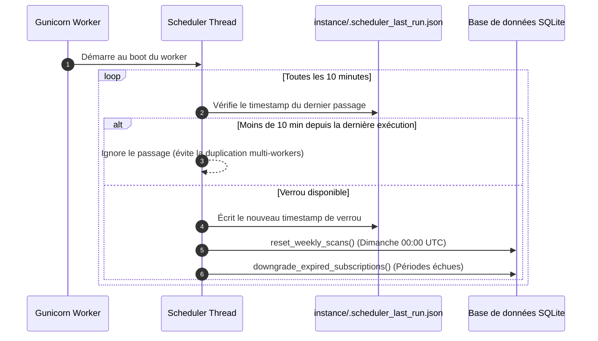

# Architecture Logicielle — LivresEnClasse.com

Ce document décrit l'architecture globale, les composants d'infrastructure, l'organisation modulaire du code Flask, ainsi que le cycle de traitement d'une requête HTTP pour l'application **LivresEnClasse.com**.

---

## Sommaire

1. [Vue d'ensemble de l'infrastructure](#1-vue-densemble-de-linfrastructure)
2. [Diagramme d'architecture globale (Mermaid)](#2-diagramme-darchitecture-globale-mermaid)
3. [Organisation des répertoires](#3-organisation-des-répertoires)
4. [Cartographie des 11 Blueprints applicatifs](#4-cartographie-des-11-blueprints-applicatifs)
5. [Cycle de vie d'une requête HTTP](#5-cycle-de-vie-dune-requête-http)
6. [Tâches d'arrière-plan & Concurrence multi-workers](#6-tâches-darrière-plan--concurrence-multi-workers)
7. [Filtres Jinja2 et processeurs de contexte](#7-filtres-jinja2-et-processeurs-de-contexte)

---

## 1. Vue d'ensemble de l'infrastructure

L'application est déployée sous forme d'une pile conteneurisée via **Docker Compose** connectée au réseau partagé `proxy` :

* **Cloudflare Tunnel (`cloudflared`) & Edge** : Établit un tunnel sortant sécurisé vers le réseau périphérique Cloudflare. Le serveur ne nécessite aucun port entrant public ouvert sur le routeur ou pare-feu.
* **Traefik (Reverse Proxy & Ingress Controller)** :
  * Détecte dynamiquement le service `biblio` via les labels Docker (`traefik.enable=true`).
  * Gère la terminaison TLS automatique via le challenge DNS Cloudflare (`certresolver=cloudflare`).
  * Achemine le trafic vers le conteneur applicatif sur le port interne `5602`.
  * Intègre le middleware de sécurité **Authelia** (`authelia@docker`) pour protéger les accès administratifs (`/admin`).
* **Serveur d'application Python (Gunicorn + Flask)** :
  * Exécute l'application WSGI Flask ([`wsgi.py`](../wsgi.py) &rarr; `wsgi:app`) sur le port interne `5602`.
  * Fonctionne avec 4 workers synchrones (`-w 4`).
* **Stockage de données persistant (SQLite)** :
  * Fichier de base de données local situé dans `instance/db.sqlite`, monté via le volume Docker unique `./instance:/app/instance`.

---

## 2. Diagramme d'architecture globale (Mermaid)

```mermaid
flowchart TD
    Client[Navigateur Client / Smartphone Enseignant] -->|HTTPS Port 443| CF[Réseau Edge Cloudflare DNS + WAF + CDN]
    
    subgraph Host[Serveur Hôte Docker - Réseau proxy]
        CF -.->|Tunnel sortant chiffré| Cloudflared[Conteneur cloudflared]
        Cloudflared -->|HTTP interne| Traefik[Traefik Ingress Router\nHost: livresenclasse.com\nCertresolver: cloudflare]
        
        Traefik -.->|Contrôle d'accès /admin| Authelia[Middleware Authelia 2FA]
        
        subgraph AppStack[Application Web Flask (Service: biblio)]
            Traefik -->|Proxy HTTP :5602| Gunicorn[Gunicorn WSGI Master -w 4]
            Gunicorn --> W1[Worker 1]
            Gunicorn --> W2[Worker 2]
            Gunicorn --> W3[Worker 3]
            Gunicorn --> W4[Worker 4]
            
            W1 & W2 & W3 & W4 --> FlaskApp[Application Flask Factory create_app]
            
            FlaskApp --> Middlewares[Middlewares before_request\n- Nettoyage comptes non vérifiés\n- Routage multilingue 301/302]
            Middlewares --> Blueprints[11 Blueprints Métier]
            
            Blueprints --> SQLAlchemy[SQLAlchemy 2.0 ORM]
            SQLAlchemy --> SQLite[(Base SQLite instance/db.sqlite)]
            
            FlaskApp -.-> Scheduler[Thread Arrière-plan Background Scheduler\nLock instance/.scheduler_last_run.json]
            Scheduler -.-> SQLite
        end
        
        subgraph ExternalAPIs[Services Tiers Externes]
            FlaskApp -->|Recherche ISBN dublincore| BnF[BnF SRU API]
            FlaskApp -->|Recherche ISBN standard| GoogleBooks[Google Books API]
            FlaskApp -->|Fallback ISBN international| OpenLibrary[Open Library API]
            FlaskApp -->|Paiements & Portail| StripeAPI[Stripe API & Webhooks]
            FlaskApp -->|Envoi e-mails transactionnels| SMTP[Serveur SMTP Gmail/SSL]
            FlaskApp -->|Vérification anti-bot| hCaptcha[hCaptcha API]
        end
    end
```

---

## 3. Organisation des répertoires

```text
Bibliotheque-Flask/
├── docker-compose.yml           # Service biblio connecté à Traefik (réseau proxy)
├── wsgi.py                      # Point d'entrée WSGI de production (app = create_app())
├── pyproject.toml               # Configuration des outils Python (Ruff)
├── babel.cfg                    # Configuration d'extraction des chaînes Gettext
├── .env.example                 # Modèle des variables d'environnement
├── run.sh                       # Script shell de démarrage Gunicorn de secours
├── instance/                    # Données locales SQLite et verrous d'exécution
│   ├── db.sqlite                # Fichier SQLite principal
│   └── .scheduler_last_run.json # Horodatage de verrou multi-workers Gunicorn
├── logs/                        # Fichiers de logs applicatifs
│   └── app.log                  # Log tournant (RotatingFileHandler max 1MB x 10)
├── migrations/                  # Scripts de migration Alembic (Flask-Migrate)
│   └── versions/                # Historique des migrations de schéma
├── project/                     # Paquet applicatif principal
│   ├── __init__.py              # Factory Flask create_app(), extensions, routage i18n
│   ├── config_plans.py          # Constantes freemium (quotas, tarifs, durées)
│   ├── models.py                # Modèles de données SQLAlchemy
│   ├── query.py                 # Requêtes de recherche et agrégation optimisées
│   ├── scheduler.py             # Thread de maintenance périodique (scans, abonnements)
│   ├── email.py                 # Fonctions d'envoi d'e-mails transactionnels
│   ├── email_error.py           # Handler de notification e-mail sur erreur 500
│   ├── subscription.py          # Gestionnaire Stripe et garde d'accès Premium
│   ├── static/                  # Fichiers statiques (CSS, JS Vanilla, PWA manifest, images)
│   ├── templates/               # Templates HTML Jinja2 organisés par domaine
│   ├── translations/            # Fichiers .po et .mo (fr, en, de) pour Flask-Babel
│   └── test/                    # Suite de tests unitaires et fonctionnels Pytest
└── scripts/                     # Utilitaires de maintenance en ligne de commande
```

---

## 4. Cartographie des 11 Blueprints applicatifs

Toutes les routes de l'application sont découpées en **11 Blueprints** modulaires enregistrés au démarrage dans [`project/__init__.py`](../project/__init__.py) sous le préfixe de langue dynamique `/<lang_code>` :

| Blueprint | Préfixe d'URL | Rôle et fonctionnalités couvertes |
| :--- | :--- | :--- |
| **`main`** | `/<lang_code>` | Pages vitrines d'accueil, mentions légales, CGU, sélection de langue (`/set-lang/<lang>`). |
| **`auth`** | `/<lang_code>` | Inscription, connexion, déconnexion, confirmation d'e-mail, réinitialisation de mot de passe, validation hCaptcha. |
| **`livre`** | `/<lang_code>/livre` | Inventaire, ajout manuel, scan code-barres (multi-APIs BnF/Google/OpenLib), modification, suppression, fiches détails. |
| **`eleve`** | `/<lang_code>/eleve` | Roster des élèves, création individuelle, import CSV, suppression, statistiques d'emprunts par élève. |
| **`emprunt`** | `/<lang_code>/emprunt`| Prise d'emprunt, retour d'emprunt, liste des retards, historique des lectures avec flou freemium (`.loan-blurred`). |
| **`subscription`**| `/<lang_code>` | Grille tarifaire (`/tarifs`), Stripe Checkout, Customer Portal (`/portail-abonne`), Webhook Stripe sans CSRF (`/webhook/stripe`). |
| **`admin`** | `/<lang_code>/admin`| Console d'administration, supervision des utilisateurs, bascule de statut Fondateur, métriques d'usage. |
| **`feedback`** | `/<lang_code>` | Formulaire de signalement de bug et retour utilisateur avec capture d'écran optionnelle. |
| **`newsletter`**| `/<lang_code>` | Inscription/désinscription à la lettre d'information, pixel de tracking d'ouverture, gestion des campagnes. |
| **`etiquette`** | `/<lang_code>` | Génération PDF de planches de codes-barres vectoriels et d'étiquettes de bacs thématiques (`@premium_required`). |
| **`ressource`** | `/<lang_code>` | Fiches pédagogiques, marque-pages imprimables, diplômes de lecteur à télécharger. |

---

## 5. Cycle de vie d'une requête HTTP

1. **Réseau & Sécurité** :
   * La requête traverse le réseau périphérique Cloudflare (chiffrement TLS, protection WAF / DDoS) et emprunte le tunnel sortant `cloudflared`.
   * **Traefik** reçoit le flux, applique le certificat Let's Encrypt / Cloudflare (`certresolver=cloudflare`), et vérifie si le middleware **Authelia** doit être sollicité (pour les URL d'administration `/admin`).
   * Traefik transmet la requête au service `biblio` (Gunicorn) sur le port `5602` via le réseau Docker `proxy`.
2. **Initialisation & Middlewares Flask (`before_request`)** :
   * **`cleanup_unverified_accounts`** : Une fois par 24h, vérifie et purge les comptes créés depuis plus de 7 jours dont l'e-mail n'a pas été validé.
   * **`handle_language_routing`** :
     * Ignore les fichiers statiques et les endpoints techniques racine (`/sitemap.xml`, `/webhook/stripe`, etc.).
     * Si un paramètre d'URL obsolète `?lang=xx` est détecté : redirection permanente **301** vers `/<lang_code>/chemin`.
     * Si l'URL ne comporte aucun préfixe de langue : calcule la langue préférée (session > compte utilisateur > en-tête `Accept-Language` du navigateur > fallback `fr`) et émet une redirection temporaire **302** avec l'en-tête HTTP `Vary: Accept-Language, Cookie`.
3. **Pré-traitement de l'URL & Contexte Babel** :
   * `@app.url_value_preprocessor` extrait `lang_code`, l'affecte à `g.lang_code`, synchronise la session et met à jour `current_user.preferred_language` si l'utilisateur est authentifié.
4. **Injection de contexte Jinja2 (`context_processor`)** :
   * Injection des constantes freemium (`max_students`, `max_books`, `max_scans`, `history_months`, `price_monthly`, `price_yearly`).
   * Injection des helpers d'internationalisation (`get_locale()`, `lang_url()`, `format_date()`).
5. **Traitement de la vue (View Function)** :
   * Vérification des décorateurs de sécurité (`@login_required`, `@premium_required`, etc.).
   * Requêtes ORM SQLAlchemy vers SQLite (`instance/db.sqlite`).
   * Rendu du template Jinja2 ou émission d'une réponse JSON/Redirection.
6. **Journalisation (`after_request`)** :
   * La requête est inscrite dans `logs/app.log` via le `RotatingFileHandler`.

---

## 6. Tâches d'arrière-plan & Concurrence multi-workers

Le fichier [`project/scheduler.py`](../project/scheduler.py) démarre un thread daemon en tâche de fond au sein de l'application Flask :



---

## 7. Filtres Jinja2 et processeurs de contexte

L'application injecte des filtres personnalisés configurés dans [`project/__init__.py`](../project/__init__.py) :

* **`|format_date`** : Formate les objets `date` et `datetime` selon la locale active (`fr`, `en`, `de`) ou retourne une chaîne vide si `None`.
* **`|replace("%%", "%")`** : Permet de restaurer les caractères pourcent littéraux dans les chaînes Gettext protégées.
* **`current_user.is_premium`** : Propriété hybride vérifiant si l'utilisateur est Fondateur, en cours d'essai ou titulaire d'un abonnement Stripe actif.
