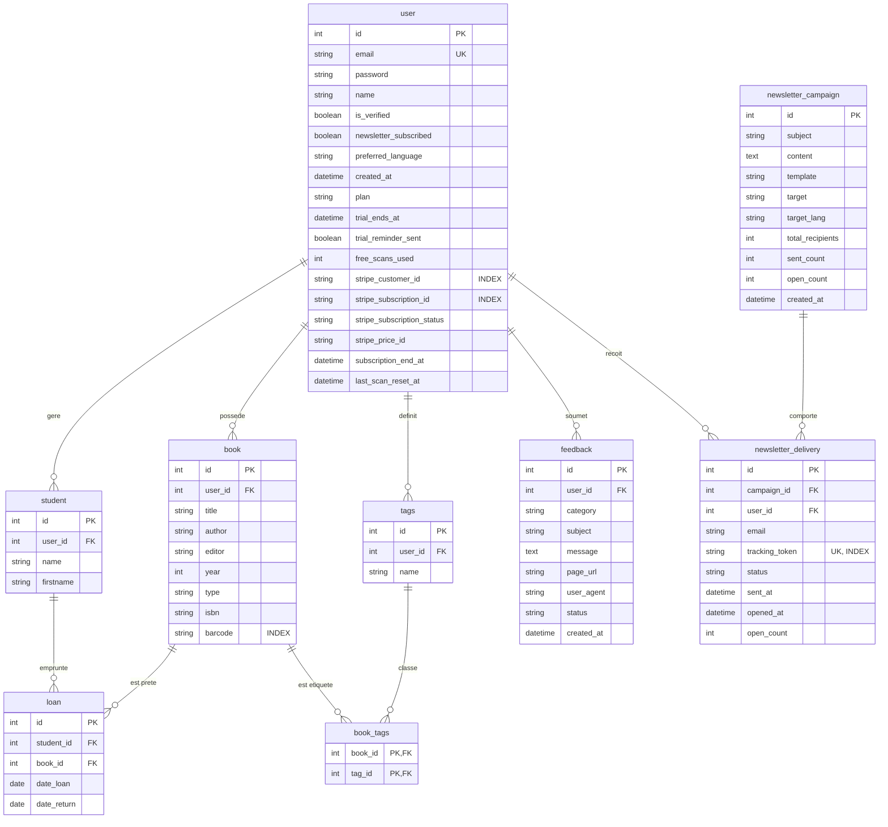

# Base de données - Livres en Classe

Ce document détaille la structure relationnelle, le schéma de données, la gestion des migrations Alembic, ainsi que les procédures de sauvegarde et de restauration de **Livres en Classe**.

---

## Sommaire

1. [Moteur et Emplacement](#1-moteur-et-emplacement)
2. [Diagramme Entité-Relation (Mermaid)](#2-diagramme-entité-relation-mermaid)
3. [Dictionnaire des données](#3-dictionnaire-des-données)
   * [Table `user`](#table-user)
   * [Table `book`](#table-book)
   * [Table `student`](#table-student)
   * [Table `loan`](#table-loan)
   * [Table `tags`](#table-tags)
   * [Table `book_tags`](#table-book_tags)
   * [Table `feedback`](#table-feedback)
   * [Table `newsletter_campaign`](#table-newsletter_campaign)
   * [Table `newsletter_delivery`](#table-newsletter_delivery)
4. [Gestion des migrations (Flask-Migrate / Alembic)](#4-gestion-des-migrations-flask-migrate--alembic)
5. [Initialisation et jeux de données de test](#5-initialisation-et-jeux-de-données-de-test)
6. [Stratégie de sauvegarde et de restauration](#6-stratégie-de-sauvegarde-et-de-restauration)
7. [Questions ouvertes](#7-questions-ouvertes)

---

## 1. Moteur et Emplacement

* **SGBD par défaut** : SQLite 3.
* **Fichier de base de données** : `instance/db.sqlite` (créé automatiquement au premier démarrage).
* **Configuration** : Variable d'environnement `SQLALCHEMY_DATABASE_URI` (défaut : `sqlite:///db.sqlite` résolu dans le dossier `instance/`).
* **Multi-environnements** : En production avec Gunicorn, `db.create_all()` est ignoré (`is_production = True`), le schéma est géré exclusivement par les migrations Alembic pour garantir l'intégrité des tables.

---

## 2. Diagramme Entité-Relation (Mermaid)



---

## 3. Dictionnaire des données

### Table `user`
Représente un compte enseignant inscrit sur la plateforme.

| Colonne | Type SQL | Nullable | Valeur par défaut / Contrainte | Rôle |
| :--- | :--- | :---: | :--- | :--- |
| `id` | `INTEGER` | Non | Clé primaire (`autoincrement`) | Identifiant unique de l'utilisateur. |
| `email` | `VARCHAR(100)` | Oui | `UNIQUE` | Adresse e-mail de connexion. |
| `password` | `VARCHAR(100)` | Oui | Aucun | Empreinte du mot de passe haché (Werkzeug `scrypt` ou `pbkdf2`). |
| `name` | `VARCHAR(1000)`| Oui | Aucun | Nom d'usage / Civilité de l'enseignant. |
| `is_verified` | `BOOLEAN` | Oui | `False` | Indique si l'e-mail a été validé par le lien d'activation. |
| `newsletter_subscribed` | `BOOLEAN` | Non | `True` | Consentement à recevoir les e-mails d'information. |
| `preferred_language` | `VARCHAR(5)` | Non | `'fr'` | Langue de l'interface (`fr`, `en`, `de`). |
| `created_at` | `DATETIME` | Non | `utcnow()` | Horodatage d'inscription. |
| `plan` | `VARCHAR(20)` | Non | `'free'` | Formule active : `'free'`, `'trial'`, `'premium'`, `'founder'`. |
| `trial_ends_at` | `DATETIME` | Oui | Aucun | Date/heure d'expiration de la période d'essai gratuit. |
| `trial_reminder_sent` | `BOOLEAN` | Non | `False` (`server_default='0'`) | Drapeau évitant l'envoi multiple des rappels de fin d'essai. |
| `free_scans_used` | `INTEGER` | Non | `0` (`server_default='0'`) | Nombre de scans de codes-barres réussis utilisés cette semaine. |
| `stripe_customer_id` | `VARCHAR(120)` | Oui | `INDEX` | Identifiant client Stripe (`cus_...`). |
| `stripe_subscription_id`| `VARCHAR(120)` | Oui | `INDEX` | Identifiant d'abonnement Stripe (`sub_...`). |
| `stripe_subscription_status`| `VARCHAR(30)` | Oui | Aucun | État Stripe (`active`, `past_due`, `canceled`). |
| `stripe_price_id` | `VARCHAR(120)` | Oui | Aucun | Identifiant du tarif Stripe souscrit. |
| `subscription_end_at` | `DATETIME` | Oui | Aucun | Date d'échéance d'accès payant après résiliation. |
| `last_scan_reset_at` | `DATETIME` | Oui | Aucun | Horodatage de la dernière remise à zéro hebdomadaire des scans. |

### Table `book`
Représente un exemplaire de livre présent dans la classe.

| Colonne | Type SQL | Nullable | Contraintes / Index | Rôle |
| :--- | :--- | :---: | :--- | :--- |
| `id` | `INTEGER` | Non | Clé primaire | Identifiant du livre. |
| `title` | `VARCHAR(100)` | Oui | Aucun | Titre de l'ouvrage. |
| `author` | `VARCHAR(100)` | Oui | Aucun | Nom(s) de l'auteur / illustrateur. |
| `editor` | `VARCHAR(100)` | Oui | Aucun | Maison d'édition. |
| `year` | `INTEGER` | Oui | Aucun | Année de publication. |
| `type` | `VARCHAR(100)` | Oui | Aucun | Genre littéraire ou nom de collection. |
| `isbn` | `VARCHAR(100)` | Oui | Aucun | Code ISBN officiel commercial (10 ou 13 chiffres). |
| `barcode` | `VARCHAR(100)` | Oui | `INDEX` | Identifiant étiquette interne classe (ex: `BAC-A-001`). |
| `user_id` | `INTEGER` | Oui | Clé étrangère `user.id` | Propriétaire de la bibliothèque. |

### Table `student`
Représente un élève d'une classe.

| Colonne | Type SQL | Nullable | Contraintes | Rôle |
| :--- | :--- | :---: | :--- | :--- |
| `id` | `INTEGER` | Non | Clé primaire | Identifiant unique de l'élève. |
| `name` | `VARCHAR(100)` | Oui | Aucun | Nom de famille. |
| `firstname` | `VARCHAR(100)` | Oui | Aucun | Prénom. |
| `user_id` | `INTEGER` | Oui | Clé étrangère `user.id` | Enseignant responsable de l'élève. |

### Table `loan`
Historique et suivi des emprunts de livres par les élèves.

| Colonne | Type SQL | Nullable | Contraintes | Rôle |
| :--- | :--- | :---: | :--- | :--- |
| `id` | `INTEGER` | Non | Clé primaire | Identifiant unique de l'emprunt. |
| `student_id` | `INTEGER` | Non | Clé étrangère `student.id` | Élève emprunteur. |
| `book_id` | `INTEGER` | Non | Clé étrangère `book.id` | Livre prêté. |
| `date_loan` | `DATE` | Oui | Aucun | Date de sortie du livre. |
| `date_return`| `DATE` | Oui | Aucun | Date effective de retour (`NULL` si actuellement prêté). |

### Table `tags`
Catégories et étiquettes créées par l'enseignant pour organiser ses bacs de livres.

| Colonne | Type SQL | Nullable | Contraintes | Rôle |
| :--- | :--- | :---: | :--- | :--- |
| `id` | `INTEGER` | Non | Clé primaire | Identifiant de l'étiquette. |
| `name` | `VARCHAR(100)` | Oui | Aucun | Libellé de l'étiquette (ex: `"Romans"`, `"Documentaires"`). |
| `user_id` | `INTEGER` | Non | Clé étrangère `user.id` | Propriétaire de l'étiquette. |

### Table `book_tags`
Table de liaison many-to-many entre livres et étiquettes.

| Colonne | Type SQL | Nullable | Contraintes | Rôle |
| :--- | :--- | :---: | :--- | :--- |
| `book_id` | `INTEGER` | Non | PK composite, FK `book.id` | Référence du livre. |
| `tag_id` | `INTEGER` | Non | PK composite, FK `tags.id` | Référence de l'étiquette. |

### Table `feedback`
Signalements d'anomalies ou suggestions envoyées depuis la plateforme.

| Colonne | Type SQL | Nullable | Contraintes | Rôle |
| :--- | :--- | :---: | :--- | :--- |
| `id` | `INTEGER` | Non | Clé primaire | Identifiant du message. |
| `user_id` | `INTEGER` | Non | Clé étrangère `user.id` | Auteur du retour. |
| `category` | `VARCHAR(50)` | Non | `'suggestion'`, `'bug'`, `'general'` | Typologie du retour. |
| `subject` | `VARCHAR(200)`| Non | Aucun | Objet du message. |
| `message` | `TEXT` | Non | Aucun | Contenu détaillé. |
| `page_url` | `VARCHAR(255)`| Oui | Aucun | URL de la page lors de la soumission. |
| `user_agent`| `VARCHAR(255)`| Oui | Aucun | Navigateur et système d'exploitation de l'utilisateur. |
| `status` | `VARCHAR(30)` | Non | Défaut `'nouveau'` | État d'avancement (`'nouveau'`, `'en_cours'`, `'traite'`). |
| `created_at`| `DATETIME` | Non | `utcnow()` | Horodatage de réception. |

### Table `newsletter_campaign`
Campagnes d'information créées depuis le panneau d'administration.

| Colonne | Type SQL | Nullable | Contraintes | Rôle |
| :--- | :--- | :---: | :--- | :--- |
| `id` | `INTEGER` | Non | Clé primaire | Identifiant de la campagne. |
| `subject` | `VARCHAR(255)`| Non | Aucun | Objet de l'e-mail. |
| `content` | `TEXT` | Non | Aucun | Corps du message. |
| `template` | `VARCHAR(100)`| Non | Aucun | Gabarit HTML utilisé. |
| `target` | `VARCHAR(50)` | Non | Aucun | Cible (`'all'`, `'active'`, etc.). |
| `target_lang`| `VARCHAR(10)`| Non | Défaut `'all'` | Langue ciblée (`'fr'`, `'en'`, `'de'`, ou `'all'`). |
| `total_recipients`| `INTEGER`| Non | Défaut `0` | Nombre total de destinataires ciblés. |
| `sent_count`| `INTEGER` | Non | Défaut `0` | Nombre d'e-mails effectivement envoyés. |
| `open_count`| `INTEGER` | Non | Défaut `0` | Nombre total d'ouvertures uniques enregistrées. |
| `created_at`| `DATETIME` | Non | `utcnow()` | Date de création de la campagne. |

### Table `newsletter_delivery`
Suivi individuel d'acheminement et pixel d'ouverture de chaque e-mail de campagne.

| Colonne | Type SQL | Nullable | Contraintes | Rôle |
| :--- | :--- | :---: | :--- | :--- |
| `id` | `INTEGER` | Non | Clé primaire | Identifiant de livraison. |
| `campaign_id` | `INTEGER` | Non | FK `newsletter_campaign.id` (ON DELETE CASCADE) | Campagne parente. |
| `user_id` | `INTEGER` | Oui | FK `user.id` (ON DELETE SET NULL) | Compte utilisateur destinataire. |
| `email` | `VARCHAR(255)`| Non | Aucun | Adresse e-mail de réception. |
| `tracking_token`| `VARCHAR(64)`| Non | `UNIQUE`, `INDEX` | Jeton aléatoire du pixel de tracking `/email/track/<token>`. |
| `status` | `VARCHAR(30)` | Non | Défaut `'pending'` | État (`'pending'`, `'sent'`, `'failed'`). |
| `sent_at` | `DATETIME` | Oui | Aucun | Horodatage d'envoi. |
| `opened_at` | `DATETIME` | Oui | Aucun | Horodatage de première ouverture. |
| `open_count`| `INTEGER` | Non | Défaut `0` | Nombre d'affichages du pixel. |

---

## 4. Gestion des migrations (Flask-Migrate / Alembic)

Toute modification des modèles SQLAlchemy dans [`project/models.py`](../project/models.py) impose la création d'un script de migration Alembic.

### Commandes usuelles

```bash
# 1. Définir la variable d'application Flask
# Sur Windows (PowerShell) :
$env:FLASK_APP = "project"
# Sur Linux / macOS :
export FLASK_APP=project

# 2. Générer une nouvelle migration détectant les écarts de modèle
flask db migrate -m "Description de la modification"

# 3. Appliquer la migration à la base de données
flask db upgrade

# 4. Consulter la version de migration active
flask db current

# 5. Consulter l'historique complet des versions
flask db history

# 6. Annuler la dernière migration appliquée (rollback)
flask db downgrade
```

> [!WARNING]
> Sous SQLite, les modifications de colonnes (type, contrainte, renommage) nécessitent le mode **batch mode** d'Alembic (`with op.batch_alter_table("table_name") as batch_op:`). Vérifiez toujours que le script généré dans `migrations/versions/` utilise cette syntaxe.

---

## 5. Initialisation et jeux de données de test

### Environnement local & tests unitaires
* Lors de l'exécution des tests avec Pytest (`pytest`), la base de données est instanciée **en mémoire vive** (`sqlite:///:memory:`) et détruite automatiquement à la fin de chaque test, garantissant une isolation totale.
* En développement local, si le fichier `instance/db.sqlite` n'existe pas, `db.create_all()` génère automatiquement toutes les tables à la première exécution.

### Réinitialisation manuelle de la base de développement

Pour repartir d'une base locale vierge :
```bash
# Supprimer le fichier SQLite existant
rm instance/db.sqlite

# Ré-appliquer toutes les migrations depuis le début
flask db upgrade
```

---

## 6. Stratégie de sauvegarde et de restauration

Puisque la base est un fichier SQLite unique, la stratégie de sauvegarde est simple et rapide :

### Procédure de sauvegarde à chaud (Recommandée)

Pour éviter tout verrouillage d'écriture pendant une transaction en cours, utilisez la commande sécurisée `.backup` de SQLite :

```bash
# Créer une sauvegarde horodatée dans un dossier de backups
sqlite3 instance/db.sqlite ".backup backups/db_backup_$(date +%Y%m%d_%H%M%S).sqlite"
```

Dans un environnement Docker :
```bash
docker-compose exec flask sqlite3 instance/db.sqlite ".backup /app/instance/backup_$(date +%Y%m%d).sqlite"
```

### Procédure de restauration

1. Arrêter le serveur applicatif pour libérer les verrous :
   ```bash
   docker-compose stop flask
   ```
2. Remplacer le fichier de base de données :
   ```bash
   cp backups/db_backup_YYYYMMDD_HHMMSS.sqlite instance/db.sqlite
   ```
3. Vérifier les permissions du fichier (l'utilisateur exécutant Gunicorn doit avoir les droits d'écriture sur le fichier et sur le répertoire `instance/`) :
   ```bash
   chmod 664 instance/db.sqlite
   ```
4. Relancer le conteneur :
   ```bash
   docker-compose start flask
   ```

---

## 7. Questions ouvertes

* [ ] **Automatisation de la sauvegarde** : Il n'existe pas actuellement de cron de backup automatisé vers un stockage externe distant (ex: S3/Backblaze B2 ou rsync). Une tâche cron planifiée exécutant `.backup` avec envoi chiffré vers un serveur distant est recommandée en production.
