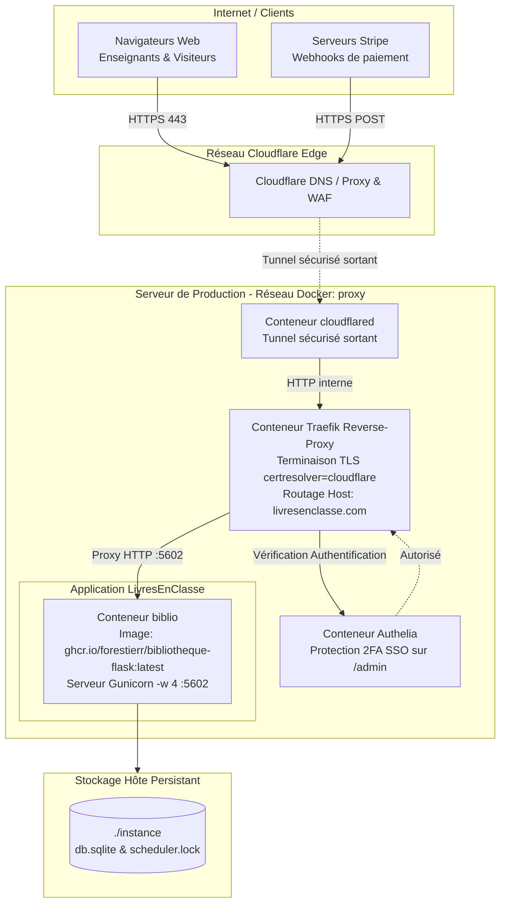

# Guide de Déploiement en Production — LivresEnClasse.com

Ce document détaille la procédure de déploiement en production de l'application **LivresEnClasse.com** sur un serveur Linux dédié ou VPS, orchestré via **Docker**, **Traefik**, **Authelia** et **Cloudflare**.

---

## Sommaire

1. [Prérequis matériels et services tiers](#1-prérequis-matériels-et-services-tiers)
2. [Architecture du déploiement en production](#2-architecture-du-déploiement-en-production)
3. [Configuration du service Docker Compose (`biblio`)](#3-configuration-du-service-docker-compose-biblio)
4. [Intégration Traefik, Certificats Cloudflare & Authelia](#4-intégration-traefik-certificats-cloudflare--authelia)
5. [Installation pas à pas sur le serveur](#5-installation-pas-à-pas-sur-le-serveur)
6. [Procédure de mise à jour (CI/CD GitHub Packages)](#6-procédure-de-mise-à-jour-cicd-github-packages)
7. [Procédure de retour en arrière (Rollback)](#7-procédure-de-retour-en-arrière-rollback)
8. [Tâches planifiées (Cron) et sauvegardes](#8-tâches-planifiées-cron-et-sauvegardes)
9. [Supervision et consultation des logs](#9-supervision-et-consultation-des-logs)

---

## 1. Prérequis matériels et services tiers

* **Serveur hôte** : Linux (Ubuntu 22.04 LTS / 24.04 LTS ou Debian 12) avec au minimum 1 vCPU, 2 Go de RAM et 20 Go d'espace disque SSD.
* **Logiciels installés** : Docker Engine (version 24+) et Docker Compose (plugin v2).
* **Nom de domaine** : `livresenclasse.com` géré via la zone DNS de Cloudflare.
* **Services tiers configurés** :
  * Compte **Stripe** (clés d'API live et secret de Webhook).
  * Compte **hCaptcha** (clés Site Key et Secret Key).
  * Serveur **SMTP** (identifiants pour l'envoi d'e-mails transactionnels).
  * Réseau Docker partagé **`proxy`** configuré sur le serveur hôte (partagé avec Traefik, Cloudflared et Authelia).

---

## 2. Architecture du déploiement en production

L'infrastructure en production abandonne tout reverse-proxy Nginx local au profit de **Traefik** comme Ingress Controller central, couplé à **Authelia** pour le contrôle d'accès et aux certificats automatiques Let's Encrypt via le challenge DNS Cloudflare :



> [!IMPORTANT]
> **Aucun port de l'application n'est exposé directement sur l'hôte** : Le conteneur Flask (`biblio`) communique exclusivement à travers le réseau Docker interne `proxy`. Seul Traefik ou Cloudflared achemine le trafic vers le port `5602`.

---

## 3. Configuration du service Docker Compose (`biblio`)

Sur le serveur de production, le service est déclaré dans le fichier [`docker-compose.yml`](../docker-compose.yml) :

```yaml
version: '3.8'

services:
  biblio:
    container_name: biblio
    image: ghcr.io/forestierr/bibliotheque-flask:latest
    command: gunicorn -w 4 -b 0.0.0.0:5602 wsgi:app
    env_file:
      - .env
    environment:
      - FLASK_RUN_HOST=0.0.0.0
      - FLASK_ENV=production
    restart: unless-stopped
    networks:
      - proxy
    labels:
      - "traefik.enable=true"
      - "traefik.http.routers.biblio.rule=Host(`livresenclasse.com`)"
      - "traefik.http.routers.biblio.entrypoints=https"
      - "traefik.http.routers.biblio.tls=true"
      - "traefik.http.routers.biblio.tls.certresolver=cloudflare"
      - "traefik.http.services.biblio.loadbalancer.server.port=5602"
      - "traefik.http.routers.biblio.middlewares=authelia@docker"
    volumes:
      # CRUCIAL : On ne monte QUE le dossier instance (qui contient db.sqlite et les verrous).
      # On ne monte surtout PAS tout le dossier racine pour ne pas écraser le code packagé dans l'image GHCR !
      - ./instance:/app/instance

networks:
  proxy:
    external: true
```

> [!CAUTION]
> **Règle absolue sur les volumes Docker** :  
> Ne jamais monter le répertoire entier (`- .:/app`) en production. Cela écraserait les fichiers pré-packagés, optimisés et testés de l'image `ghcr.io` par les fichiers locaux de l'hôte. Seul le dossier d'état persistant (`./instance:/app/instance`) doit être monté.

---

## 4. Intégration Traefik, Certificats Cloudflare & Authelia

### 1. Certificats TLS automatiques (`certresolver=cloudflare`)
Traefik est configuré pour solliciter automatiquement des certificats Let's Encrypt valides via le challenge DNS de Cloudflare, permettant le renouvellement transparent sans nécessiter d'ouvrir le port 80 HTTP vers l'extérieur.

### 2. Protection administrative par Authelia (`authelia@docker`)
Le label `"traefik.http.routers.biblio.middlewares=authelia@docker"` rattache le middleware d'authentification centralisé Authelia.

Pour que **seules les pages d'administration** (`/admin`, `/fr/admin`, etc.) exigent la double authentification Authelia tandis que le reste du site demeure public :

**Configuration Authelia (`configuration.yml`)** :
```yaml
access_control:
  default_policy: bypass # Le site général et les webhooks restent accessibles
  rules:
    - domain: "livresenclasse.com"
      resources:
        - "^/([a-z]{2}/)?admin/.*"
        - "^/admin.*"
      policy: two_factor # Exige l'authentification 2FA pour l'espace d'administration
```

*(Alternative possible : scinder en deux routeurs Traefik dans le compose : `biblio` avec `Host('livresenclasse.com')` sans middleware, et `biblio-admin` avec règle `Host('livresenclasse.com') && PathPrefix('/admin')` avec priorité plus haute et le middleware `authelia@docker`).*

---

## 5. Installation pas à pas sur le serveur

### Étape 1 : Réseau Docker partagé
Assurez-vous que le réseau Docker externe partagé existe :
```bash
docker network create proxy || true
```

### Étape 2 : Préparer l'arborescence et le dossier d'instance
```bash
mkdir -p /opt/Bibliotheque-Flask/instance
mkdir -p /opt/Bibliotheque-Flask/backups
cd /opt/Bibliotheque-Flask
```

### Étape 3 : Configurer l'environnement (`.env`)
Renseignez les variables de production dans `/opt/Bibliotheque-Flask/.env` :
```bash
SECRET_KEY='generer_une_chaine_aleatoire_tres_longue_et_securisee'
LOG_LEVEL=INFO
FLASK_ENV=production
SQLALCHEMY_DATABASE_URI='sqlite:///db.sqlite'

# E-mail transactionnel (SMTP SSL)
MAIL_SERVER='smtp.gmail.com'
MAIL_PORT=465
MAIL_USERNAME='contact@livresenclasse.com'
MAIL_PASSWORD='mot_de_passe_application_smtp'
MAIL_USE_TLS=False
MAIL_USE_SSL=True

# Google Books API
GOOGLE_BOOK_API_KEY='cle_api_google_books'

# hCaptcha (Anti-bot)
HCAPTCHA_SITE_KEY='cle_site_hcaptcha'
HCAPTCHA_SECRET_KEY='cle_secrete_hcaptcha'

# Stripe Live
STRIPE_PUBLIC_KEY='pk_live_...'
STRIPE_SECRET_KEY='sk_live_...'
STRIPE_WEBHOOK_SECRET='whsec_...'
STRIPE_PRICE_MONTHLY='price_...'
STRIPE_PRICE_YEARLY='price_...'
```

### Étape 4 : Télécharger l'image et démarrer le conteneur
```bash
docker compose pull biblio
docker compose up -d biblio
```

### Étape 5 : Exécuter les migrations de base de données
```bash
docker compose exec biblio flask db upgrade
```

---

## 6. Procédure de mise à jour (CI/CD GitHub Packages)

L'image Docker officielle est construite automatiquement par GitHub Actions ([`.github/workflows/ghcr-publish.yml`](../.github/workflows/ghcr-publish.yml)) à chaque push ou merge sur `main` / `master` et publiée sur GitHub Container Registry (`ghcr.io/forestierr/bibliotheque-flask:latest`).

Pour déployer la nouvelle version sur le serveur :

```bash
cd /opt/Bibliotheque-Flask

# 1. Sauvegarde préventive de la base de données
sqlite3 instance/db.sqlite ".backup backups/pre_deploy_$(date +%Y%m%d_%H%M%S).sqlite"

# 2. Télécharger la dernière image GHCR
docker compose pull biblio

# 3. Recréer le conteneur avec la nouvelle image
docker compose up -d biblio

# 4. Appliquer les migrations de schéma Alembic si nécessaire
docker compose exec biblio flask db upgrade

# 5. Vérifier la bonne santé du conteneur
docker compose logs --tail=50 biblio
```

---

## 7. Procédure de retour en arrière (Rollback)

Si une anomalie survient après la mise à jour :

```bash
cd /opt/Bibliotheque-Flask

# 1. Rétrograder la base de données si une migration défaillante a été passée
docker compose exec biblio flask db downgrade

# 2. Démarrer une version ou un SHA spécifique de l'image Docker
# Exemple : modifier temporairement l'image dans le compose vers un tag antérieur ou commit SHA :
# image: ghcr.io/forestierr/bibliotheque-flask:<SHA_ANCIEN>
docker compose up -d biblio

# 3. Restaurer la sauvegarde de la base si elle a été corrompue
docker compose stop biblio
cp backups/pre_deploy_YYYYMMDD_HHMMSS.sqlite instance/db.sqlite
docker compose start biblio
```

---

## 8. Tâches planifiées (Cron) et sauvegardes

### 1. Scheduler interne (Intégré dans le conteneur)
Le planificateur natif Flask tourne en continu en tâche de fond dans le conteneur `biblio` ([`project/scheduler.py`](../project/scheduler.py)) :
* Réinitialise les 30 scans hebdomadaires chaque dimanche à 00:00:00 UTC.
* Rétrograde en formule gratuite les abonnements échus.

### 2. Tâches Cron sur le serveur hôte
Ajoutez ces tâches dans la crontab de l'hôte (`crontab -e`) :

```bash
# Sauvegarde quotidienne SQLite à 03h00 (conserve 30 jours d'historique)
0 3 * * * sqlite3 /opt/Bibliotheque-Flask/instance/db.sqlite ".backup /opt/Bibliotheque-Flask/backups/db_$(date +\%Y\%m\%d).sqlite" && find /opt/Bibliotheque-Flask/backups/ -name "db_*.sqlite" -mtime +30 -delete

# Envoi des e-mails de rappel de fin d'essai gratuit à 09h00
0 9 * * * cd /opt/Bibliotheque-Flask && docker compose exec -T biblio python scripts/send_trial_ending_reminders.py >> /opt/Bibliotheque-Flask/instance/cron_reminders.log 2>&1
```

---

## 9. Supervision et consultation des logs

| Composant | Commande d'inspection |
| :--- | :--- |
| **Logs de l'application Flask / Gunicorn** | `docker compose logs -f biblio` |
| **Logs des routeurs & certificats Traefik** | `docker logs -f traefik` |
| **Logs d'authentification Authelia** | `docker logs -f authelia` |
| **Logs du tunnel Cloudflare** | `docker logs -f cloudflared` |
| **État des migrations SQLite** | `docker compose exec biblio flask db current` |
| **Vérification du verrou du scheduler** | `cat instance/.scheduler_last_run.json` |
